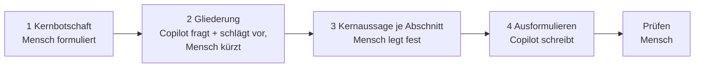

# Lab 3.1: Vom Stichpunkt zum Bericht – der Mensch entscheidet

**Leitfragen:**

<details>
<summary>Wer entscheidet heute, was in einem Bericht zuerst steht?</summary>

Die Person, die den Bericht verantwortet. Wer „Schreib mir einen Bericht" an Copilot gibt, überlässt diese Entscheidung dem wahrscheinlichsten Muster (Lab 1.1).

</details>

<details>
<summary>Was fragt eine gute Kollegin nach, bevor sie einen Auftrag annimmt?</summary>

Für wen, wozu, wie lang, was ist das Wichtigste, was soll danach passieren. Genau diese Fragen kann Copilot zuerst stellen, bevor es schreibt.

</details>

<details>
<summary>Welche Teile eines Berichts sind Entscheidung, welche nur Formulierung?</summary>

Entscheidung: Kernbotschaft, Gliederung, Gewichtung. Formulierung: die Sätze dazwischen. Nur die Formulierung lässt sich ohne Risiko abgeben.

</details>

- Ein einziger Prompt für ein ganzes Dokument gibt die inhaltlichen Entscheidungen mit ab.
- Human in the Loop teilt die Arbeit in vier Schritte: der Mensch entscheidet, Copilot formuliert aus.

## Begriffe

| Begriff | Bedeutung |
| ------- | --------- |
| Ein-Prompt-Auftrag | Ein Dokument mit einem einzigen Prompt komplett erzeugen lassen („Schreib mir einen Bericht"). Nicht verwechseln mit Few-Shot aus Lab 2.1, wo es um Beispiele geht. |
| Human in the Loop (HITL) | Der Mensch bleibt in jedem Schritt beteiligt und trifft die Entscheidungen; wie eine Projektleitung, die ein Team führt, statt alles selbst zu tippen. |
| Kernbotschaft | Der eine Satz, den der Leser behalten soll, wenn er nur den Anfang liest. |
| Gliederung | Reihenfolge und Auswahl der Abschnitte; entscheidet, was wichtig wirkt. |
| Kernaussage | Die eine Aussage, die ein Abschnitt belegen soll. |
| Rückfragen zuerst | Prompt-Technik: Copilot stellt vor dem Schreiben Fragen und schreibt erst nach den Antworten. |

## Word mit Copilot 2026

Copilot öffnet sich in Word als Bereich am rechten Rand; dort stehen Prompts, Rückfragen und Antworten, das Ergebnis landet im Dokument.


_Quelle: Microsoft Support, „How Copilot Chat works in Microsoft 365 apps" (https://support.microsoft.com/en-us/microsoft-365-copilot/how-copilot-chat-works-in-microsoft-365-apps), abgerufen am 31.10.2026._

## Neu 2026 in Word

- **Copilot bearbeitet direkt im Dokument:** Seit Juni 2026 ändert Copilot im Chat standardmäßig den Text im Dokument selbst; jede Änderung ist nachvollziehbar und rückgängig zu machen, die Funktion lässt sich abschalten ([Release Notes, 02.06.2026](https://learn.microsoft.com/en-us/microsoft-365/copilot/release-notes)).
- **Entwerfen, umbauen, Ton anpassen:** Die agentischen Funktionen in Word sind seit April 2026 allgemein verfügbar: Entwürfe schreiben, umformulieren, neu strukturieren und den Ton an das Publikum anpassen ([Microsoft 365 Blog, 22.04.2026](https://www.microsoft.com/en-us/copilot/blog/2026/04/22/copilots-agentic-capabilities-in-word-excel-and-powerpoint-are-generally-available/)).
- **Datei als Quelle:** Über „Reference a file" bzw. `/` arbeitet Copilot mit einer bestimmten Datei als Grundlage, statt selbst nach Inhalten zu suchen ([Microsoft Support](https://support.microsoft.com/en-us/word/copilot/start-from-exist)).

Stand: 31.10.2026. Oberfläche und Funktionsumfang hängen von Lizenz, Tenant-Einstellungen und Rollout ab; vor dem Kurs im eigenen Tenant prüfen.

## Das Problem mit dem Ein-Prompt-Auftrag

Copilot muss bei „Schreib mir einen Statusbericht" Entscheidungen treffen, die niemand vorgegeben hat. Es wählt dann das Wahrscheinlichste, nicht das Gewollte.

| Was abgegeben wird | Was passiert |
| ------------------ | ------------ |
| Kernbotschaft | Copilot wählt die naheliegendste, nicht die gewollte |
| Gliederung | Standardaufbau statt Argumentationslinie |
| Gewichtung | alle Punkte gleich lang, unabhängig von der Wichtigkeit |
| Ausformulierung | unproblematisch, das ist die eigentliche Stärke |

> **Merksatz:** Nicht das Denken abgeben, sondern das Tippen. Die Entscheidungen bleiben beim Menschen.

## Human in the Loop in vier Schritten

Der Ablauf führt vom Stichpunkt zum Bericht; nach jedem Schritt entscheidet der Mensch, ob es weitergeht.



| Schritt | Was passiert | Wer entscheidet | Rolle von Copilot |
| ------- | ------------ | --------------- | ----------------- |
| 1 Kernbotschaft | Botschaft und Adressat in ein bis zwei Sätzen | Mensch | schärft die Formulierung, bietet Alternativen an |
| 2 Gliederung | Abschnitte klären und kürzen | Mensch | stellt Rückfragen, schlägt Struktur vor |
| 3 Kernaussagen | je Abschnitt eine Aussage festlegen | Mensch | prüft Belege in der Quelle, meldet Lücken |
| 4 Ausformulieren | Text aus Schritt 1–3 schreiben | Copilot | formuliert aus |

Nach Schritt 3 ist die inhaltliche Arbeit getan. Der Gesamtaufwand ähnelt dem Ein-Prompt-Auftrag, fällt aber vorne an, wo Korrekturen billig sind.

Grenzen: Für kurze Texte ist der Ablauf Mehraufwand, ab etwa einer Seite lohnt er. Falsche Zahlen verhindert er nicht; dafür bleibt der Prüfschritt.

## Prompt-Technik: Rückfragen zuerst

Copilot schreibt sofort los, auch wenn wichtige Angaben fehlen. Ein Satz im Prompt dreht das um: erst fragen, dann schreiben.

**Beispiel-Eingabe:**

```text
Ich brauche eine Gliederung für einen einseitigen Statusbericht. Grundlage ist /nordwind-stichpunkte.docx. Stelle mir zuerst bis zu fünf Fragen, bevor du die Gliederung erstellst.
```

**Beispiel-Ausgabe (gekürzt):**

```text
1. Wer liest den Bericht (Lenkungskreis, Fachbereich, Geschäftsführung)?
2. Soll der Bericht eine Entscheidung anstoßen? Wenn ja, welche?
3. Wie ausführlich sollen die Arbeitspakete dargestellt werden: Tabelle oder Fließtext?
4. Sollen Risiken mit Gegenmaßnahmen genannt werden?
5. Gibt es eine feste Vorlage oder Reihenfolge der Abschnitte?
```

| Vorteile | Nachteile |
| -------- | --------- |
| Lücken im Auftrag werden sichtbar, bevor Text entsteht | eine Runde mehr, bevor ein Ergebnis da ist |
| die Antworten sind genau die Entscheidungen, die beim Menschen bleiben sollen | Copilot fragt manchmal Unwichtiges; nur relevante Fragen beantworten |

**Wann ja:** bei längeren Dokumenten, neuen Aufgaben oder wenn der Auftrag noch unscharf ist.
**Wann nicht:** bei kurzen Routineaufgaben mit klarem Auftrag (eine Mail kürzen, einen Absatz umformulieren).

Die Technik ergänzt die Prompt-Formel aus Lab 1.2: Copilot fragt nach genau den Teilen von Ziel, Kontext, Quelle und Erwartung, die noch fehlen.

## Bezug zum Nextise Agentic Way

Die vier Schritte sind der [Nextise Agentic Way](../../m01-copilot-intro/00-nextise-agentic-way.md) im Kleinen: (1) Problem verstehen = Kernbotschaft und Rückfragen, (2) Lösung konzipieren = Gliederung und Kernaussagen, (3) Lösung bauen = Copilot formuliert aus. Der Mensch führt die KI, statt ihr jeden Handgriff zu diktieren.

## Prüfschritt vor dem Weitergeben

1. Zahlen und Termine: gegen die Quelldatei abgeglichen?
2. Namen und Bezeichnungen: korrekt und vollständig?
3. Stand: Welche Quelle ist neuer, wenn zwei Dateien sich widersprechen?
4. Freigabe: Eine benannte Person verantwortet den Bericht, nicht Copilot.

## Typische Fehler

| Symptom | Ursache | Lösung |
| ------- | ------- | ------ |
| Copilot schreibt sofort den ganzen Bericht | Rückfragen-Satz fehlt oder ist zu weich („gerne auch Fragen stellen") | „Stelle mir zuerst bis zu fünf Fragen, bevor du …" wörtlich als letzten Satz anfügen |
| Gliederung mit acht oder mehr Abschnitten | Vorschlag abgenickt statt gekürzt | auf höchstens sechs Abschnitte streichen, jede Streichung kurz begründen |
| Bericht länger als eine Seite | Länge nicht vorgegeben | „höchstens eine Seite" in Schritt 4 nennen, danach „kürze auf eine Seite" |
| Zahl im Bericht weicht von den Projektnotizen ab | zwei Quellen mit unterschiedlichem Stand | Datum beider Quellen vergleichen, die neuere verwenden und den Stand nennen |
| `/`-Befehl findet die Datei nicht | Datei liegt nicht im eigenen OneDrive | Kursdatei ins eigene OneDrive kopieren, Namen neu eingeben |

## Fazit

- Kernbotschaft, Gliederung und Gewichtung entscheidet der Mensch; das Ausformulieren übernimmt Copilot.
- „Stelle mir zuerst bis zu fünf Fragen" macht Lücken im Auftrag sichtbar, bevor Text entsteht.
- Eine abgenickte Gliederung ist kein Human in the Loop: Schritt 2 lebt vom Streichen.
- Jede Zahl wird gegen die Quelle geprüft, auch nach vier sauberen Schritten.

In der Übung entsteht aus `nordwind-stichpunkte.docx` in vier Schritten ein einseitiger Statusbericht.
