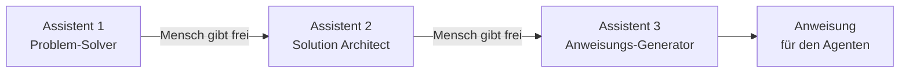

# Lab 5.2: KI baut KI: einen eigenen Agenten entwerfen und anlegen

**Leitfragen:**

<details>
<summary>Was muss ein neuer Helpdesk-Mitarbeiter am ersten Tag wissen?</summary>

Wofür er zuständig ist, wo die richtigen Antworten stehen, wie er antworten soll und was er an andere abgibt. Genau diese vier Punkte (Zweck, Quelle, Stil, Grenzen) braucht auch die Anweisung eines Agenten.

</details>

<details>
<summary>Wer schreibt eine Stellenbeschreibung für einen Assistenten schneller: ein Mensch allein oder ein Mensch mit Copilot?</summary>

Ein Mensch mit Copilot: Copilot fragt nach, schlägt vor und formuliert aus, der Mensch entscheidet. So schreibt KI die Anweisung für eine andere KI („KI baut KI").

</details>

<details>
<summary>Wie lässt sich prüfen, ob eine Antwort aus der Richtlinie stammt und nicht ausgedacht ist?</summary>

Mit einer Testfrage, deren Antwort nur in der Richtlinie steht (z. B. Passwortlänge), und der Pflicht, den Abschnitt zu nennen. Ohne diese Prüfung bleibt eine Halluzination (Lab 1.1) unentdeckt.

</details>

- Copilot entwirft den Agenten in drei Schritten; der Mensch gibt jeden Schritt frei.
- Der Agent Builder in Copilot Chat speichert das Ergebnis als Agent mit Anweisungen und Wissen.

## Begriffe

| Begriff | Bedeutung |
| ------- | --------- |
| Agent Builder | der Baukasten für eigene Agenten direkt in Copilot Chat, ohne Programmierung |
| Anweisungen (*Instructions*) | das Textfeld mit dem festen Auftrag an den Agenten, höchstens 8.000 Zeichen |
| Wissen (*Knowledge*) | Dateien oder Seiten, auf die sich der Agent stützt; hochgeladene Dateien bis zu 20 Stück |
| Startvorschläge (*Starter prompts*) | Beispielfragen, die beim Öffnen des Agenten zum Anklicken erscheinen |
| Testbereich (*Try it*) | Chatfenster im Agent Builder, um den Agenten vor dem Speichern zu prüfen |

## Der Nextise Agentic Way am eigenen Agenten

Aus dem Auftakt bekannt: KI führen statt jeden Handgriff selbst machen, Problem vor Lösung (Hintergrund: [The Nextise Agentic Way](../../m01-copilot-intro/00-nextise-agentic-way.md)). Beim Agenten heißt das:

| Schritt | Copilot liefert den Entwurf | Der Mensch entscheidet |
| ------- | --------------------------- | ---------------------- |
| 1. Problem verstehen | stellt bis zu fünf Rückfragen (Technik „Rückfragen zuerst" aus Lab 3.1) | beantwortet sie mit eigenem Wissen, z. B. dem Ergebnis aus Lab 4.1 |
| 2. Agent konzipieren | schlägt Zweck, Zielgruppe, Wissen und Grenzen vor | streicht, ergänzt, gibt frei |
| 3. Anweisung schreiben | formuliert den fertigen Text für das Feld „Anweisungen" | prüft und testet |

In größeren Vorhaben übernimmt jeden Schritt ein eigener Assistent; im Kurs fasst Prompt-Karte 8 die Kette in einem Chat zusammen:



## Was eine gute Anweisung enthält

| Teil | Frage | Beispiel Nordwind IT-Helfer |
| ---- | ----- | --------------------------- |
| Zweck | Wofür ist der Agent da, für wen? | IT-Standardfragen der Mitarbeitenden |
| Quelle | Woraus antwortet er? | nur aus der IT-Richtlinie, Abschnitt nennen |
| Stil | Wie antwortet er? | freundlich, Deutsch, höchstens fünf Sätze |
| Grenzen | Was lehnt er ab, wohin verweist er? | Gehalt, Personalfragen, Sonderrechte; nie nach Passwörtern fragen |

Microsoft empfiehlt dieselbe Gliederung (Zweck, allgemeine Leitlinien mit Ton und Einschränkungen, bei Bedarf Schritte, Fehlerbehandlung und Beispiele). Anweisungen gehören in das Feld „Anweisungen", nicht in eine Wissensdatei. Die Anweisung spricht den Agenten direkt an; die Du-Form ist dort üblich. Das Beispiel liegt auch als [`nordwind-agent-anweisung.md`](../../project/nordwind-agent-anweisung.md) bereit (Fallback).

```text
Du bist der „Nordwind IT-Helfer", der interne Assistent für IT-Standardfragen bei Nordwind Consulting.   <- Rolle

**Zweck:** Beantworte Fragen der Mitarbeitenden zu VPN und Remote-Zugriff, Geräten und Passwörtern
sowie zum IT-Support-Kontakt.                                                                          <- Zweck

**Quelle:** Antworte ausschließlich auf Basis der hinterlegten IT-Richtlinie. Nenne am Ende jeder
Antwort den Abschnitt der Richtlinie, auf den sich die Antwort stützt.                                <- Quelle

**Stil:** Antworte freundlich, auf Deutsch, in höchstens fünf Sätzen oder einer kurzen nummerierten
Schrittfolge.                                                                                         <- Stil

**Grenzen:**                                                                                          <- Grenzen
- Wenn die Richtlinie eine Frage nicht beantwortet, sage das offen und verweise auf das Ticket-Portal
  it-support.nordwind-consulting.example. Erfinde keine Antwort.
- Beantworte keine Fragen zu Gehalt, Urlaub, Personalangelegenheiten oder individuellen Sonderberechtigungen;
  verweise an HR bzw. das Ticket-Portal.
- Frage nie nach Passwörtern oder anderen Zugangsdaten.
```

_Quelle: Microsoft Learn, „Write effective instructions for declarative agents" (https://learn.microsoft.com/en-us/microsoft-365/copilot/extensibility/declarative-agent-instructions), Seitenstand 11.08.2026, abgerufen am 31.10.2026._

## Der Agent Builder in Copilot Chat


_Quelle: Microsoft Learn, „Build agents in Agent Builder" (https://learn.microsoft.com/en-us/microsoft-365/copilot/extensibility/agent-builder-build-agents), Seitenstand 26.10.2026, abgerufen am 31.10.2026._

| Schritt | Ort in der Oberfläche |
| ------- | --------------------- |
| Agent Builder öffnen | Copilot Chat (microsoft365.com/chat oder Teams) → linke Leiste **New agent** |
| per Gespräch beschreiben | Registerkarte **Describe**: Copilot füllt Name, Beschreibung und Anweisungen selbst aus |
| Felder selbst füllen | **Skip to configure** → Registerkarte **Configure** |
| Name / Beschreibung | **Name** (bis 30 Zeichen), **Description** (bis 1.000 Zeichen) |
| Anweisung einfügen | **Instructions** (bis 8.000 Zeichen) |
| Wissen hochladen | **Knowledge** → **Upload**, z. B. `nordwind-it-richtlinie.docx` |
| Beispielfragen | **Starter Prompts** |
| testen | Registerkarte **Try it**, aktiv sobald Name, Beschreibung und Anweisungen gefüllt sind |
| speichern | **Create**; der Agent ist danach privat und nur für die eigene Person sichtbar, **Share** gibt ihn später frei |

Im Agent Builder gibt es keine Aktionen, die externe Dienste ansteuern; dafür lässt sich der Agent nach Microsoft Copilot Studio kopieren, ein eigenes Werkzeug für umfangreichere Agenten (Lab 5.3). Bezeichnungen sind hier aus der englischen Dokumentation; in deutscher Oberfläche können sie übersetzt sein. Ob der Agent Builder verfügbar ist, entscheidet die IT-Administration in der Microsoft-365-Umgebung des Unternehmens (Tenant). Stand: 31.10.2026, vor Kursbeginn prüfen.

## Neu 2026 im Agent Builder

- **Anweisungen per Gespräch:** Die Registerkarte **Describe** erzeugt Anweisungen mit Leitlinien, Schritten, Fehlerbehandlung und Beispielen ([Microsoft Learn](https://learn.microsoft.com/en-us/microsoft-365/copilot/extensibility/agent-builder-build-agents), Seitenstand 26.10.2026).
- **Antwortmodus:** Unter **Model** lässt sich der Standard festlegen: **Auto**, **Quick response** oder **Think deeper** ([Microsoft Learn](https://learn.microsoft.com/en-us/microsoft-365/copilot/extensibility/agent-builder-build-agents), Seitenstand 26.10.2026).
- **Skills:** Einem Agenten lassen sich Skills hinzufügen, also abgegrenzte Teilaufgaben mit eigenen Anweisungen, als Paket oder per Beschreibung in natürlicher Sprache ([Microsoft Learn](https://learn.microsoft.com/en-us/microsoft-365/copilot/extensibility/agent-builder), Seitenstand 26.10.2026).

Stand: 31.10.2026. Verfügbarkeit hängt von Lizenz und Tenant-Einstellungen ab; vor Kursbeginn prüfen.

## Testen vor dem Teilen

| Testfrage | Prüft | Gutes Verhalten |
| --------- | ----- | --------------- |
| Frage, deren Antwort in der Richtlinie steht | Grounding | Antwort stimmt mit der Richtlinie überein und nennt den Abschnitt |
| Frage außerhalb des Zwecks | Grenzen | lehnt freundlich ab und verweist an die richtige Stelle |

- Der Schalter **Only use specified sources** (unter **Knowledge**) lässt den Agenten die eigenen Quellen bevorzugen; allgemeines Modellwissen sperrt er nicht. Die Grenzen gehören deshalb in die Anweisung.
- Hochgeladene Dateien sehen später alle, mit denen der Agent geteilt wird; nur Dateien hochladen, die alle sehen dürfen.

_Quelle: Microsoft Learn, „Add knowledge sources to an agent in Agent Builder" (https://learn.microsoft.com/en-us/microsoft-365/copilot/extensibility/agent-builder-add-knowledge), Seitenstand 30.09.2026, abgerufen am 31.10.2026._

> **Merksatz:** Copilot schreibt die Anweisung, der Mensch entscheidet Zweck und Grenzen und prüft mit zwei Testfragen.

## Typische Fehler

| Symptom | Ursache | Lösung |
| ------- | ------- | ------ |
| Copilot schreibt sofort die Anweisung, ohne zu fragen | Prompt verlangt keine Pause | Prompt-Karte 8 unverändert nutzen; nachschieben: „Stelle zuerst die Fragen." |
| Agent beantwortet die Urlaubsfrage frei | Grenzen fehlen oder sind zu vage | Grenze mit Beispiel und Verweis an HR ergänzen, erneut testen |
| Agent nennt kein Detail aus der Richtlinie | Datei noch nicht fertig hochgeladen (grau) oder fehlt | unter **Knowledge** prüfen, warten, neu testen |
| **Try it** ist nicht anklickbar | Name, Beschreibung oder Anweisungen leer | alle drei Felder füllen |
| **New agent** fehlt | Agent Builder im Tenant nicht freigegeben | Fallback der Übung nutzen |

## Fazit

- KI baut KI: Copilot fragt nach, konzipiert und schreibt die Anweisung; der Mensch gibt jeden Schritt frei.
- Eine gute Anweisung enthält Zweck, Quelle, Stil und Grenzen.
- Der Agent Builder speichert Anweisung und Wissen; zwei Testfragen zeigen, ob der Agent aus der Quelle antwortet und Grenzen einhält.

Die Übung entwirft mit Prompt-Karte 8 den „Nordwind IT-Helfer" und legt ihn im Agent Builder an.
