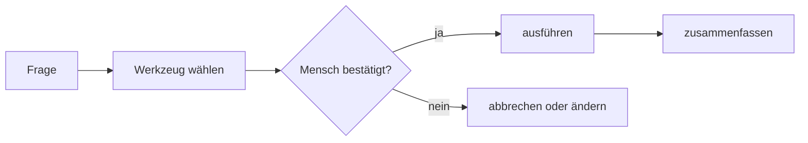

# Lab 5.3: Vom Antworten zum Handeln: Agenten mit MCP verbinden

**Leitfragen:**

<details>
<summary>Was fehlt einem Assistenten, der nur Auskunft gibt, aber nichts erledigen kann?</summary>

Die Möglichkeit zu handeln: ein Ticket anlegen, eine Nachricht senden, Daten aus einem Fachsystem holen. Solche Fähigkeiten heißen Aktionen.

</details>

<details>
<summary>Wie viele verschiedene Ladekabel lagen früher in der Schublade – und warum heute nicht mehr?</summary>

Früher hatte fast jedes Gerät einen eigenen Stecker; heute passt USB-C an viele Geräte, weil es ein gemeinsamer Standard ist. MCP ist ein solcher gemeinsamer Stecker zwischen KI-Agenten und Werkzeugen.

</details>

- Wissen lässt einen Agenten antworten, Aktionen lassen ihn handeln.
- MCP ist der offene Standard, über den ein Agent fremde Werkzeuge nutzt; jede ändernde Aktion braucht eine Bestätigung.

## Begriffe

| Begriff | Bedeutung |
| ------- | --------- |
| Aktion | eine Fähigkeit, mit der ein Agent in einem anderen System etwas erledigt, z. B. ein Ticket anlegen |
| Werkzeug (*Tool*) | eine einzelne Aktion mit Name, Beschreibung und Eingabefeldern, die ein Agent aufrufen kann |
| MCP (Model Context Protocol) | offener Standard, über den KI-Anwendungen sich mit Werkzeugen und Daten anderer Systeme verbinden; wie USB-C für KI |
| MCP-Server | ein Programm, das über MCP Werkzeuge eines Systems anbietet, z. B. „Tickets suchen" und „Ticket anlegen" |
| Bestätigung | der Mensch prüft und erlaubt eine Aktion, bevor der Agent sie ausführt (Human in the Loop aus Lab 3.1) |

## Antworten oder Handeln

| | nur Wissen (Lab 5.2) | Wissen + Aktionen |
| - | -------------------- | ----------------- |
| Frage „Mein VPN-Zertifikat ist abgelaufen" | erklärt: Erneuerung durch die IT, Ticket-Portal nutzen | legt nach Bestätigung selbst ein Ticket an |
| Ergebnis | eine Antwort | eine erledigte Aufgabe plus Antwort |
| Risiko | falsche Auskunft | falsche Auskunft und falsche Änderung im System |

## MCP auf einen Blick

- **Bild:** USB-C für KI: ein Stecker statt einer eigenen Anbindung für jedes System.
- **Definition:** „MCP (Model Context Protocol) is an open-source standard for connecting AI applications to external systems." ([modelcontextprotocol.io](https://modelcontextprotocol.io/docs/getting-started/intro), abgerufen am 31.10.2026)
- **25.11.2024:** Anthropic veröffentlicht MCP als offenen Standard ([Anthropic](https://www.anthropic.com/news/model-context-protocol)).
- **19.05.2025:** Microsoft zeigt auf der Build eine frühe Vorschau von MCP in Windows 11 ([Windows Blog](https://blogs.windows.com/windowsexperience/2025/05/19/securing-the-model-context-protocol/)).
- **29.05.2025:** MCP ist in Microsoft Copilot Studio allgemein verfügbar ([Microsoft Copilot Blog](https://www.microsoft.com/en-us/microsoft-copilot/blog/copilot-studio/model-context-protocol-mcp-is-now-generally-available-in-microsoft-copilot-studio/)).

## So wählt ein Agent ein Werkzeug

Ein MCP-Server meldet seine Werkzeuge mit Name, Beschreibung und Eingabefeldern; der Agent liest die Beschreibung und entscheidet, ob ein Werkzeug zur Frage passt. Ein Werkzeug sieht vereinfacht so aus:

```json
{
  "name": "ticket_anlegen",
  "description": "Legt ein neues Ticket im IT-Support an. Nur nach Bestätigung durch die Nutzerin oder den Nutzer verwenden.",
  "inputSchema": {
    "type": "object",
    "properties": {
      "kategorie": { "type": "string" },
      "beschreibung": { "type": "string" }
    }
  }
}
```

- `name`: wie das Werkzeug heißt; `description`: wann der Agent es nutzen soll (wichtigstes Feld);
- `inputSchema`: welche Angaben das Werkzeug braucht; die Details sind für Anwendende ignorierbar.

Ablauf einer Aktion, vom Auftrag bis zur Rückmeldung:



## Die Demo

Fiktive Demo-Umgebung: ein Demo-Agent nach dem Vorbild des „Nordwind IT-Helfers", verbunden mit einem MCP-Server „Nordwind Tickets" mit zwei Werkzeugen.

| Werkzeug | Art | Bestätigung |
| -------- | --- | ----------- |
| `tickets_suchen` | lesend: zeigt vorhandene Tickets | nicht nötig |
| `ticket_anlegen` | ändernd: legt ein Ticket an | vor jeder Ausführung |

1. Frage: „Mein VPN-Zertifikat ist abgelaufen, bitte leg ein Ticket an."
2. Der Agent prüft die Richtlinie (Erneuerung durch die IT) und sucht mit `tickets_suchen` nach einem offenen Ticket: keines vorhanden.
3. Er wählt `ticket_anlegen` und zeigt den Entwurf: Kategorie VPN, Beschreibung „VPN-Zertifikat abgelaufen, Erneuerung erbeten". Er fragt: „Soll ich das Ticket so anlegen?"
4. Nach „Ja" legt er das Ticket an und fasst zusammen: Ticketnummer, nächster Schritt, Hotline werktags 08:00–18:00 Uhr.

## Lesende und ändernde Werkzeuge

| Art | Beispiele | Regel |
| --- | --------- | ----- |
| lesend | Ticketstatus abfragen, Kalender lesen, Datensatz anzeigen | Verbindung braucht Freigabe; einzelne Aufrufe ohne Bestätigung |
| ändernd | Ticket anlegen, Mail senden, Termin buchen, Datensatz löschen | Bestätigung vor jeder Ausführung; Entwurf zuerst zeigen |

## Wo MCP in Microsoft 365 vorkommt

| Werkzeug | MCP | Für wen |
| -------- | --- | ------- |
| Agent Builder in Copilot Chat (Lab 5.2) | keine Aktionen für externe Dienste; Agent lässt sich dafür nach Copilot Studio kopieren | alle mit Freigabe |
| Microsoft Copilot Studio (Werkzeug für umfangreichere Agenten mit Aktionen und Abläufen) | MCP-Server als Werkzeug hinzufügen (**Add a tool**); unterstützt Werkzeuge und Ressourcen | Fachbereiche mit Studio-Zugang, IT |
| Microsoft 365 Agents Toolkit (Erweiterung für das Programmierwerkzeug Visual Studio Code) | MCP-Server als Plugin eines Agenten (**Start with an MCP Server**) | Entwicklung |

Stand: 31.10.2026; Verfügbarkeit hängt von Lizenz und Tenant ab, vor Kursbeginn prüfen.

_Quellen: Microsoft Learn, „Agent Builder overview" (https://learn.microsoft.com/en-us/microsoft-365/copilot/extensibility/agent-builder), Seitenstand 26.10.2026; „Extend your agent with Model Context Protocol" (https://learn.microsoft.com/en-us/microsoft-copilot-studio/agent-extend-action-mcp), Seitenstand 26.08.2026; „Build a plugin for a declarative agent from an MCP server" (https://learn.microsoft.com/en-us/microsoft-365/copilot/extensibility/build-mcp-plugins), Seitenstand 30.09.2026; alle abgerufen am 31.10.2026._

## Sicherheit

- Jede Verbindung gibt dem Agenten mehr Zugriff: wer betreibt den MCP-Server, welche Werkzeuge bietet er an, welche Daten fließen?
- Verbindungen richtet nur ein, wer dafür eine Freigabe der IT hat; bei externen MCP-Servern trägt das Unternehmen die Verantwortung für die genutzten Werkzeuge.
- Ändernde Aktionen bestätigt immer ein Mensch, nachdem er den Entwurf gesehen hat. Die allgemeinen Regeln stehen in Lab 6.1.

> **Merksatz:** Lesen darf der Agent nach Freigabe der Verbindung, ändern nur nach Bestätigung durch einen Menschen.

## Fazit

- Wissen lässt einen Agenten antworten, Aktionen lassen ihn handeln.
- MCP ist der offene Standard („USB-C für KI"); ein MCP-Server bietet Werkzeuge mit Name und Beschreibung an, der Agent wählt.
- Jede Verbindung braucht eine Freigabe, jede ändernde Aktion eine Bestätigung.

Die Übung wertet die Demo in einem kurzen Quiz aus.
