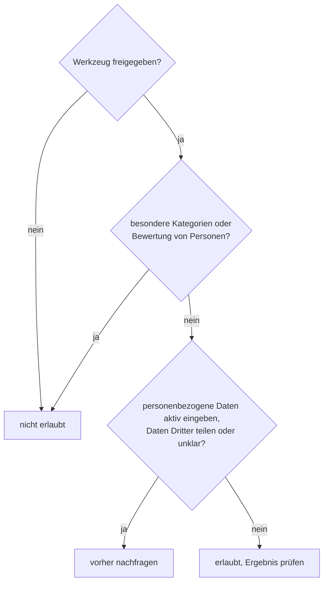

# Lab 6.1: Regeln für den sicheren Einsatz

**Leitfragen:**

<details>
<summary>Was darf in eine Mail an einen Externen, was nicht?</summary>

Nur, was der Empfänger wissen darf: keine internen Zahlen ohne Freigabe, keine Daten anderer Personen, nichts Vertrauliches. Für einen Prompt gilt dieselbe Vorsicht, denn auch er gibt Daten an ein Werkzeug weiter.

</details>

<details>
<summary>Ist es ein Unterschied, ob ein Name eingetippt oder in einer vorhandenen Mail zusammengefasst wird?</summary>

Ja. Eintippen gibt neue personenbezogene Daten aktiv in ein Werkzeug. Beim Zusammenfassen verarbeitet Copilot Inhalte, auf die bereits Zugriff besteht, im freigegebenen System (Grounding aus Lab 1.1); auch dafür gelten die Regeln der eigenen KI-Richtlinie.

</details>

<details>
<summary>Wer haftet für einen Text, den ein Assistent geschrieben hat?</summary>

Die Person, die ihn freigibt und verwendet. Ein Werkzeug kann einen Fehler erzeugen, aber keine Verantwortung übernehmen.

</details>

- Sechs Regeln decken die meisten Situationen ab; im Zweifel gilt: vorher nachfragen.
- Dieses Handout ist eine allgemeine Orientierung, **keine Rechtsberatung**. Verbindlich sind die KI-Richtlinie des eigenen Unternehmens und die dort genannten Ansprechpartner.

## Begriffe

| Begriff | Bedeutung |
| ------- | --------- |
| personenbezogene Daten | alle Angaben, die sich einer bestimmten Person zuordnen lassen: Name, Mailadresse, Telefonnummer, Personalnummer |
| besondere Kategorien personenbezogener Daten | besonders geschützte Angaben nach Art. 9 der Datenschutz-Grundverordnung (DSGVO), z. B. Gesundheit, Religion, politische Meinung |
| freigegebenes Werkzeug | eine KI-Anwendung, ein Modell oder eine Erweiterung, die das Unternehmen ausdrücklich zur Nutzung erlaubt hat |
| KI-Richtlinie | das interne Regelwerk des Unternehmens für den Einsatz von KI, mit Liste der freigegebenen Werkzeuge und Ansprechpartnern |
| Vorfall | ein Ereignis, bei dem Daten an die falsche Stelle gelangt sind oder ein KI-Ergebnis Schaden anrichten kann |

## Sechs Regeln

| Nr. | Regel | Beispiel |
| --- | ----- | -------- |
| 1 | Nur freigegebene Werkzeuge, Modelle und Erweiterungen nutzen; das gilt auch für Agenten und MCP-Verbindungen (Lab 5.3) | Microsoft 365 Copilot mit Work IQ ja; eine private KI-App oder Browsererweiterung ohne Freigabe nein |
| 2 | Personenbezogene Daten nicht ohne Klärung aktiv eingeben | keine Namen, Adressen oder Personalnummern in einen Prompt tippen, hineinkopieren oder als Wissen hochladen, ohne vorher bei der zuständigen Stelle nachzufragen |
| 3 | Besondere Kategorien personenbezogener Daten nie verwenden | keine Diagnose aus einer Krankmeldung, keine Religionszugehörigkeit |
| 4 | Keine Bewertung von Personen durch KI | keine Rangfolge von Bewerbungen, keine Leistungsbeurteilung, keine Personalentscheidung |
| 5 | Jedes Ergebnis mit dem Prüfraster prüfen | Zahlen und Namen gegen die Quelle abgleichen, bevor ein Text das Haus verlässt |
| 6 | Vorfälle sofort melden | falsche Datei im Prompt, fremde Inhalte in einer Antwort, falsches Ergebnis bereits verschickt |

**Zu Regel 2:** Eingeben und Auswerten sind zweierlei. Aktiv eingegebene Daten kommen neu ins Werkzeug. Fasst Copilot dagegen eine vorhandene Mail im freigegebenen Microsoft-365-Umfeld zusammen, arbeitet es nur mit Inhalten, auf die bereits Zugriff besteht. Ob und wofür das erlaubt ist, regelt die eigene KI-Richtlinie.

**Zu Regel 3:** Art. 9 DSGVO nennt Angaben zu ethnischer Herkunft, politischen Meinungen, religiösen oder weltanschaulichen Überzeugungen, Gewerkschaftszugehörigkeit, genetische und biometrische Daten, Gesundheit sowie Sexualleben und sexueller Orientierung.

**Zu Regel 4:** Die KI-Verordnung der EU (EU AI Act) ordnet KI-Systeme für Auswahl von Bewerbungen, Beförderung, Kündigung und Leistungsbewertung als Hochrisiko-Systeme ein (Anhang III Nr. 4). Entscheidungen über Menschen bleiben beim Menschen.

_Quellen: Verordnung (EU) 2016/679 (DSGVO), Art. 9 (https://eur-lex.europa.eu/legal-content/DE/TXT/?uri=CELEX:32016R0679); Verordnung (EU) 2024/1689 (KI-Verordnung), Anhang III (https://eur-lex.europa.eu/legal-content/DE/TXT/?uri=CELEX:32024R1689); abgerufen am 31.10.2026. Allgemeine Orientierung, keine Rechtsberatung._

## Das Prüfraster

Gilt für jedes KI-Ergebnis, egal ob in Outlook, Word, PowerPoint, Excel oder von einem Agenten:

```text
1. Zahlen und Fristen: gegen die Originalquelle abgeglichen?
2. Namen und Bezeichnungen: korrekt und vollständig?
3. Rechtlich bindende Formulierungen: von der Fachabteilung freigegeben?
4. Textnähe: erkennbar von einer bestimmten fremden Quelle übernommen?
5. Freigabe: durch eine namentlich benannte Person?
```

## Erlaubt, nicht erlaubt oder vorher nachfragen?

Die Fragen in dieser Reihenfolge prüfen:



- „Vorher nachfragen" heißt: bei der Stelle, die die eigene KI-Richtlinie nennt (z. B. Datenschutz, IT-Sicherheit, Vorgesetzte).
- Wer ein nicht freigegebenes Werkzeug braucht, beantragt die Freigabe, statt es vorher zu nutzen.

## Die eigene KI-Richtlinie

Jedes Unternehmen regelt den KI-Einsatz selbst. Diese Punkte lohnt es, in der eigenen Richtlinie nachzuschlagen:

| Frage | Typische Stelle in der Richtlinie |
| ----- | --------------------------------- |
| Welche Werkzeuge, Modelle und Erweiterungen sind freigegeben? | Liste oder Anhang der freigegebenen Werkzeuge |
| Welche Daten dürfen in welches Werkzeug? | Abschnitt zu Datenklassen und Datenschutz |
| Wer beantwortet Fragen, wer nimmt Vorfälle entgegen? | Ansprechpartner und Meldeweg |
| Dürfen eigene Agenten angelegt und geteilt werden? | Abschnitt zu Agenten oder Erweiterungen |

> **Merksatz:** Im Zweifel nicht eingeben, sondern vorher nachfragen; die Verantwortung für ein Ergebnis bleibt beim Menschen.

## Grenzen

- Dieses Handout ersetzt weder die KI-Richtlinie des eigenen Unternehmens noch eine rechtliche Prüfung.
- Eine einmal eingegebene Angabe lässt sich nicht zuverlässig zurückholen; geprüft wird vor dem Absenden.

## Fazit

- Nur freigegebene Werkzeuge, personenbezogene Daten nur nach Klärung aktiv eingeben, besondere Kategorien nie, keine Bewertung von Personen.
- Jedes Ergebnis durchläuft das Prüfraster; Vorfälle werden sofort gemeldet.
- Verbindlich ist die eigene KI-Richtlinie; im Zweifel vorher nachfragen.

Die Übung ordnet fünf Situationen ein und hält drei persönliche Regeln fest.
